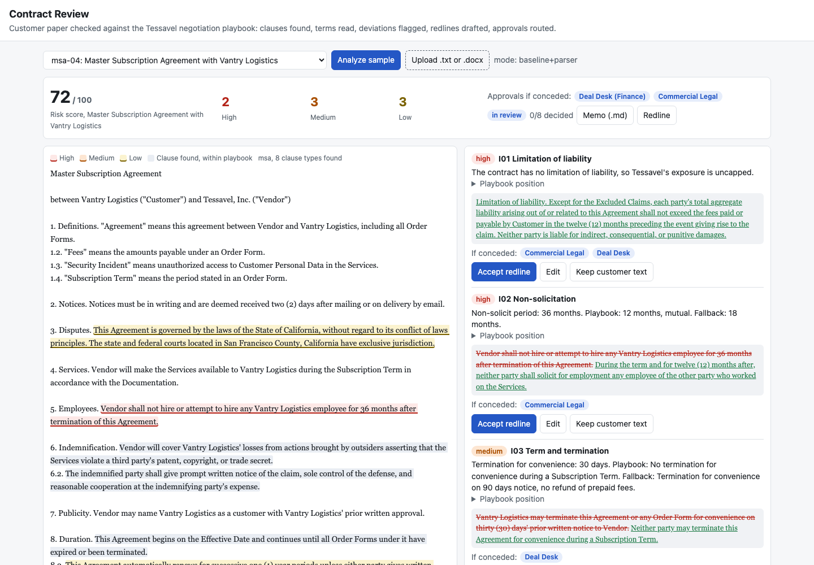

# Contract Review

A contract review aid for a SaaS vendor's commercial team. It reads incoming customer paper (MSAs, DPAs, order forms), finds the clauses, reads the negotiated terms (liability cap, notice periods, payment days, breach notice hours, and 17 more), compares each one to the company's negotiation playbook, and drafts a redline with the reason and the approver needed if the team concedes. Missing clauses are flagged too. A reviewer accepts, edits, or rejects each redline in a web UI, approvals are routed by the playbook rules, every action lands in an audit trail, and the result exports as a Markdown review memo and a tracked-changes HTML redline. The vendor is Tessavel, a made-up SaaS company, and the 40 contracts are synthetic, written from clause templates in this repo.

**This is a review aid, not legal advice.** It points a reviewer at the clauses that need attention. A lawyer still decides.



**Evaluation** on 40 labeled contracts (24 MSAs, 8 DPAs, 8 order forms; 281 labeled clauses, 222 labeled deviations, 6 missing required clauses). `contractreview eval --compare`:

| Metric | Baseline (keywords + similarity, parsers) | Model-assisted, simulated client |
|---|---:|---:|
| Clause detection precision (micro) | 100.0% | 100.0% |
| Clause detection recall (micro) | 97.2% | 98.9% |
| Parameter extraction accuracy | 79.3% | 96.0% |
| &nbsp;&nbsp;on standard phrasing | 99.7% | 95.4% |
| &nbsp;&nbsp;on unusual phrasing (parsers not tuned on it) | 39.5% | 97.0% |
| Deviation precision | 96.8% | 97.0% |
| Deviation recall | 79.0% | 98.7% |
| **High-severity deviation recall** | **86.4%** | **95.5%** |
| Missing clause recall | 100.0% | 100.0% |
| Severity agreement | 100.0% | 96.4% |
| Redline judge score (1 to 5) | 4.70 | 4.71 |
| Model calls | 0 | 80 |

How to read it:

- About 30% of clause paragraphs are reworded in plainer, less contract-like language ("Customer may cancel this Agreement whenever it chooses by notifying Supplier in writing 30 days in advance"). Those phrasings were written after the parsers, and the parsers were not tuned on them. On the standard templates the parsers are nearly perfect (99.7%), on the reworded ones they read 39.5%. That gap is the honest picture of a regex baseline, and it is why deviation recall is 79%.
- The second column runs the Claude classifier and extractor against a **simulated client** that answers from the ground truth and is wrong 5% of the time. It checks the model-assisted plumbing (prompt shape, quote validation, fallbacks, two calls per contract). It is not a measurement of Claude. Run `contractreview eval --mode claude` with a key for a real number.
- Severity agreement is 100% for the baseline because when a parser reads a value it reads it exactly; its errors are values it does not find. The simulated model's errors are wrong values, which shows up as severity disagreement.
- The redline judge re-reads each proposed redline with the parsers and checks it lands on the playbook position (5), a fallback (4), or still deviates (2). An LLM judge plugs into the same interface.

CI fails the build if high-severity deviation recall for the baseline drops below 80%.

Per clause type, baseline detection:

| Clause type | Precision | Recall |
|---|---:|---:|
| limitation_of_liability | 100.0% | 100.0% |
| indemnification | 100.0% | 95.8% |
| termination | 100.0% | 100.0% |
| payment_terms | 100.0% | 100.0% |
| auto_renewal | 100.0% | 86.7% |
| governing_law | 100.0% | 92.9% |
| confidentiality | 100.0% | 100.0% |
| data_protection | 100.0% | 100.0% |
| warranties | 100.0% | 100.0% |
| assignment | 100.0% | 100.0% |
| non_solicit | 100.0% | 95.0% |
| insurance | 100.0% | 100.0% |

## Why

Commercial contracts are where a SaaS company quietly takes on risk. A customer's MSA arrives with an uncapped data breach carve-out, net 90 payment, termination for convenience on 15 days notice, and consent rights over every subprocessor, and the deal desk needs to know within a day which of those are fine, which need finance or security to sign off, and what to send back. Legal ops teams automate this first because the work is repetitive and the playbook already exists, usually as a spreadsheet nobody reads. The hard parts are not the comparison: customer paper numbers its sections its own way, splits one clause across three sections, defines the cap in the definitions and uses it 20 pages later, and words the same term ten different ways. A useful tool must find the term wherever it is, show exactly which sentence it read, say which rule it broke, and keep a record of who agreed to what.

## Architecture

```
 .txt / .docx (python-docx: heading styles become "# Heading")
        |
        v
 segment.py    sections and clauses with character offsets: "1." "1.1" "1.2)" "Section 4." "ARTICLE IV -"
               "(a)" "#" ALL CAPS headings, inline headings, "Key: value" order form lines, skipped numbers,
               wrapped lines; definitions collected ('"Liability Cap" means ...'); document kind detected
        |
        v
 classify.py   BaselineClassifier: heading and body keywords + TF-IDF similarity to playbook language,
               multi-label, unlabeled clauses inherit their section's type, definitions skipped
               ClaudeClassifier (optional): JSON schema output, unknown labels dropped, baseline fallback
        |
        v
 extract.py    one deterministic parser per clause type, 21 parameters, defined terms resolved,
               evidence = value + character span of the sentence it came from
               ClaudeExtractor (optional, claude-opus-5-5): value + verbatim quote per term; a quote not
               found in the contract is rejected and the parser value kept
        |
        v
 analyze.py    playbook.yaml checks (max / min / enum / flag) -> ok, low (fallback), medium (outside
               fallback), high (walk-away); required clauses per document kind; bare references to another
               agreement are not clauses; risk score; redline per issue in the document's own party names
        |
        v
 review.py     accept / edit / reject; edits re-read by the parser and re-scored; conceding a medium or high
               issue routes to legal, finance, or security; high escalates to legal; audit trail; memo
 redline.py    tracked-changes HTML (word-level <del>/<ins>), clean text with accepted changes
 api.py        FastAPI + web UI at /, /healthz, /metrics (Prometheus), JSON logs
 evaluate.py   ground truth metrics, simulated model client, heuristic and Claude redline judges, CI gate
```

| Piece | File |
|---|---|
| Negotiation playbook: positions, fallbacks, walk-aways, approvers, model redlines | `src/contractreview/playbook.yaml` |
| Seeded corpus generator, six numbering styles, split and reworded clauses, ground truth | `src/contractreview/corpus.py` |
| Generated contracts and labels you can open | `data/contracts/*.txt`, `data/truth.jsonl` |

## How to run

```bash
cd contract-review
uv sync --python 3.12
uv run contractreview serve --port 8828      # UI at http://127.0.0.1:8828, pick a sample, click Analyze
```

Other commands:

```bash
uv run contractreview analyze data/contracts/msa-04.txt         # issues in the terminal (also .docx)
uv run contractreview eval --compare                            # the tables above
uv run contractreview eval --gate --min-high-recall 0.8         # what CI runs
uv run contractreview gen --out data                            # regenerate data/
make test lint run screenshot
```

To use Claude: `uv sync --extra claude`, set `ANTHROPIC_API_KEY`, and start the server with `CONTRACTREVIEW_MODE=claude`. Model values are only kept when their quote is found in the contract, so every value in the UI points at a real character span. `contractreview eval --mode claude` measures it on the corpus.

API: `POST /api/contracts` (multipart .txt, .md, or .docx), `POST /api/contracts/text`, `POST /api/contracts/sample/{id}`, `GET /api/contracts/{id}`, `POST .../issues/{issue}/accept|edit|reject`, `POST .../issues/{issue}/approvals`, `GET .../audit`, `GET .../memo.md`, `GET .../redline.html?pending=true`, `GET .../clean.txt`, `GET /api/playbook`, `/healthz`, `/metrics`.

Docker and the GitHub Actions workflow are built and run in CI. Docker is not needed locally: `uv run` is enough.

## Tests

116 tests, `uv run pytest -q`, about 4 seconds. They cover:

- segmentation: skipped numbers, "Section 7 (a)", "ARTICLE IV", inline headings, ALL CAPS headings vs ALL CAPS paragraphs, wrapped lines, "1.2)" and markdown headings, order form fields, definitions, and every labeled span in all 40 contracts
- every parameter parser: cap as months, multiples, percentages, and a defined term; uncapped and carve-outs; termination for convenience and cure; payment days and late interest; renewal; governing law; confidentiality term; breach hours (including business days), subprocessors, audits; warranties; assignment; non-solicit; insurance; evidence spans
- playbook comparison for every clause type and band, approver routing and escalation, required clauses by document kind
- classifier baseline, missing clause detection, references that are not clauses, redline generation with the document's party names, the redline judge
- Claude classifier and extractor against a fake client: request shape, structured output, unknown labels dropped, quotes not in the text rejected, bad JSON and refusals fall back
- review workflow: accept, edit re-scoring, reject routing, wrong-role and double approvals, send back, ready to sign, audit trail, memo, redline HTML, clean text
- eval metrics, seeded corpus, the gate, simulated model mode, docx ingestion, and the API end to end

## Production notes

- The parsers cover the standard phrasings and miss the long tail, as the table shows. At real scale, the model extractor runs on every contract, the parsers become a cross-check, and any disagreement between them goes to a reviewer instead of being resolved silently.
- The store is in memory. A real deployment keeps contracts, decisions, and the audit trail in Postgres with an append-only audit table, and pushes the final redline and memo to the CLM system.
- Reviewer and approver identity are strings in the request. Behind SSO, the approver role comes from the identity token, and an approver cannot approve their own concession.
- Customer paper arrives as Word documents with real tracked changes. Production would read and write Word revision marks (w:ins, w:del) instead of plain text and an HTML redline.
- The playbook is a YAML file in the repo, which gives it version history and review for free. Each analysis should record the playbook version it used so an old memo can be explained after the playbook changes.
- Long contracts should be analyzed as a background job, with the model calls sent through the Batches API and prompt caching on the shared system prompt.

## License

MIT. See [LICENSE](LICENSE).
